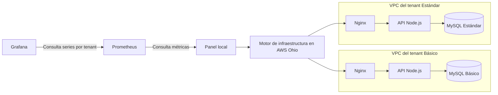
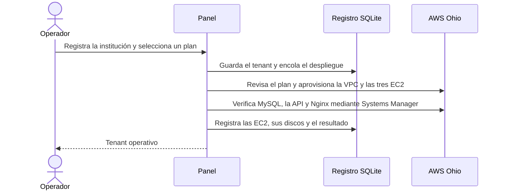

# Demostración de aislamiento entre tenants

La demo usa un tenant **Básico** y uno **Estándar**, ambos en el entorno **Pruebas** de AWS Ohio. Cada uno recibe su propia VPC, una EC2 para Nginx, otra para la API y otra para MySQL. El panel administra el ciclo de vida y Prometheus recoge las métricas mediante Systems Manager.

Este documento conserva el procedimiento y la evidencia del ensayo ya realizado. El [plan de cierre](plan-de-cierre.md#6-probar-y-documentar-la-demostración-final) define las comprobaciones adicionales para la grabación final, incluida la AMI personalizada y los resultados de escaneo en ambos tenants.

## Flujo de creación

## Preparar la demo

1. Confirma dos cupos libres en la cuota **VPCs per Region** de Ohio.
2. Inicia el [panel con el perfil de despliegue](../plataforma/README.md#despliegue-desde-el-panel) y la [observabilidad local](../observabilidad/README.md#arranque-local-en-windows).
3. Registra dos instituciones ficticias en **Pruebas**, una con cada plan. Despliega ambas y espera a que aparezcan como **Operativo**.
4. Para abrir cada aplicación, usa el [túnel de Systems Manager](../infra/opentofu/README.md) hacia su EC2 de frontend. Si alternas ambos túneles en el puerto local `8080`, cierra la sesión del navegador y el túnel al cambiar de institución. Las seis EC2 pueden permanecer en ejecución mientras alternas.

## Mostrar el aislamiento

1. En cada aplicación, inicia sesión como su administrador. Crea un módulo con nombre distinto y carga un estudiante ficticio por Excel. Usa las plantillas de **Nuevo módulo** para importar también una fecha de clase del día de la prueba.
2. En el Básico usa la matrícula `BASICO-701`. En el Estándar usa `ESTANDAR-902`. En cada institución, el estudiante propio debe poder entrar y marcar su asistencia. La matrícula del otro tenant debe recibir un rechazo.
3. Con el administrador de cada tenant, comprueba el módulo, el listado y la exportación Excel. Cada vista debe mostrar una fila con la matrícula propia y la asistencia **Presente**.
4. Suspende el Básico desde el panel. Comprueba que el Estándar siga mostrando su asistencia. Reanuda el Básico y verifica que conserva sus datos. En el historial, comprueba que la suspensión y la reanudación usaron las mismas EC2 y discos.
5. En Grafana, filtra por cada tenant y entorno. Para demostrar una alerta y su resolución en el panel, sigue el [procedimiento de caída controlada](../observabilidad/README.md#demostrar-una-alerta) sobre uno de los tenants de prueba.
6. Prepara y confirma el retiro de ambos tenants. Comprueba en el panel que cada uno terminó en estado **Retirado**.

## Evidencia del ensayo del 12 de noviembre de 2026

A las 14:32:38 en Bolivia, el panel reportó ambos tenants como operativos. AWS devolvió seis EC2 en ejecución, tres por tenant, en dos VPC distintas. Se usó OpenTofu para los dos planes. La prueba funcional se ejecutó contra la API de cada institución mediante Systems Manager.

| Tenant | Matrícula propia | Matrícula ajena | Exportación Excel |
| --- | --- | --- | --- |
| `demo-basico-mwdvnit8` | `BASICO-701` ingresó y marcó **Presente** | `ESTANDAR-902` recibió HTTP 401 | Una fila con `BASICO-701` |
| `demo-estandar-mwdvnit8` | `ESTANDAR-902` ingresó y marcó **Presente** | `BASICO-701` recibió HTTP 401 | Una fila con `ESTANDAR-902` |

Cada institución importó su lista y sus fechas desde Excel y activó su propio módulo. Al suspender el Básico, el Estándar siguió consultando y exportando su asistencia. El Básico recuperó su registro tras reanudar las mismas EC2 y los mismos discos.

A las 14:33:46, Grafana consultó seis series de disponibilidad de Nginx, la API y MySQL de ambos tenants en Prometheus. La prueba de activación y resolución de alertas se documentó en el [ensayo de observabilidad](aws-preparacion-demo.md#prueba-de-observabilidad).

AWS confirmó el retiro de los 31 recursos de OpenTofu y los tres discos raíz por tenant. Una comprobación posterior devolvió cero VPC, EC2 activas, volúmenes EBS y parámetros de arranque de la demo. Ohio volvió a siete VPC de las nueve permitidas.
