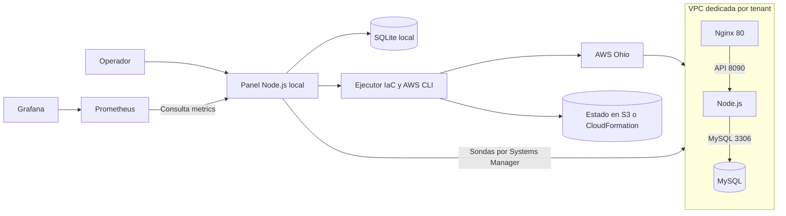

# Manual de reproducción del Proyecto Final del Módulo 2

Este manual permite a otra IA o a un operador reproducir la plataforma que administra tenants de **UAGRM Asistencia**. Describe cómo levantar el panel en Windows, preparar una cuenta de AWS, aprovisionar los tenants en **Ohio (`us-east-2`)**, verificar el aislamiento, observar alertas y retirar los recursos de prueba. Usa el código de este proyecto como fuente de verdad y ejecuta los pasos en orden.

## 1. Punto de partida y alcance

- La aplicación de asistencia se conserva en `asistencia/`. Los scripts de arranque descargan [UAGRM Asistencia](https://github.com/masterkof2021/uagrm-asistencia) en el commit `ba7a8216be0c1c836925ea8964ad463295d961d0`. Si cambias la revisión, verifica que la copia incluida, el valor HCL `app_commit` y `infra/arranque.js` se refieran al mismo código.
- Clona la rama `main` de [masterkof2021/uagrm-asistencia](https://github.com/masterkof2021/uagrm-asistencia/tree/main) para obtener el código, la infraestructura y la documentación del proyecto final. El commit `1e2a75a` contiene la versión probada que describe este manual.
- Incluye `README.md`, `.gitignore`, `asistencia/`, `plataforma/`, `infra/`, `observabilidad/` y `documentacion/`. Conserva los dos `.terraform.lock.hcl` y los `package-lock.json`. Omite `node_modules`, directorios `.terraform`, archivos de estado y planes, entornos locales, `plataforma/data/` y `observabilidad/data/` en el paquete de código.
- Para una **reproducción nueva**, crea registros nuevos en SQLite. Para **continuar un entorno existente**, conserva la base local, los directorios de despliegue y el backend remoto. Las claves locales de Pulumi deben acompañar a su pila por un canal seguro. Abrir una base vacía no recupera automáticamente el inventario de otro panel.
- Aplica los requisitos vigentes del proyecto. El alcance implementado es AWS Ohio, catálogo, aislamiento, ciclo de vida, aplicación de asistencia, historial y observabilidad. OpenTofu, Terraform, CloudFormation y Pulumi son motores ejecutables. Cloud-init hace la configuración de las EC2 de este flujo. El alcance, las exclusiones y los entregables de presentación están en [requisitos.md](requisitos.md).

La AMI privada de Packer, Ansible y los escáneres se activan desde la configuración del panel. Los cuatro motores completaron las comprobaciones de servicio en Ohio con la AMI y Ansible. [Configuración de escaneos](../plataforma/README.md#escaneos-antes-de-desplegar) · [Ensayos en Ohio](aws-preparacion-demo.md#pruebas-con-la-ami-de-packer-y-ansible).

Comprueba la copia antes de trabajar:

```powershell
git status --short
Get-Item plataforma/server.js, plataforma/planes.json, infra/opentofu/main.tf
Get-Item -Force infra/opentofu/.terraform.lock.hcl, infra/terraform/.terraform.lock.hcl
Get-Item infra/pulumi/package-lock.json, infra/cloudformation/plantilla.js
Get-Item observabilidad/prometheus.yml, observabilidad/alertas.yml
```

## 2. Arquitectura y archivos que definen el sistema



| Ruta | Implementación que debe conservarse |
| --- | --- |
| [plataforma/server.js](../plataforma/server.js), [public/](../plataforma/public/) | HTTP local en `127.0.0.1`, vistas del operador, catálogo y API administrativa. Los endpoints del panel son distintos de los de Asistencia. |
| [tenants.js](../plataforma/tenants.js), [catalogo.js](../plataforma/catalogo.js), [planes.json](../plataforma/planes.json) | Validación, registro, planes fijados al crear, historial de trabajos y eventos de alertas en SQLite. |
| [despliegues.js](../plataforma/despliegues.js), [cloudformation.js](../plataforma/cloudformation.js), [pulumi.js](../plataforma/pulumi.js) | Verificación de cuenta y rol, cola, preparación y revisión por motor, comprobaciones de AWS y retiro. |
| [infra/opentofu/](../infra/opentofu/), [infra/terraform/](../infra/terraform/), [infra/arranque.js](../infra/arranque.js) | Módulo HCL compartido, locks de proveedores separados, renderizado común de cloud-init y plantilla de IAM del panel. |
| [infra/cloudformation/](../infra/cloudformation/), [infra/pulumi/](../infra/pulumi/) | Generador de plantilla CloudFormation, reglas de seguridad y programa nativo de Pulumi. |
| [asistencia/src/](../asistencia/src/), [asistencia/database/schema.sql](../asistencia/database/schema.sql) | Presentación Express, lógica de asistencia, repositorios MySQL y esquema del tenant. |
| [monitor.js](../plataforma/monitor.js), [alertas.js](../plataforma/alertas.js), [observabilidad/](../observabilidad/) | Sondas SSM, métricas Prometheus, alertas, eventos persistidos y tablero de Grafana. |

Cada tenant crea una VPC independiente `10.248.0.0/16` con subred `10.248.1.0/24`. El frontend usa `10.248.1.10`, el backend `10.248.1.20` y MySQL `10.248.1.30` dentro de su propia VPC. Se pueden repetir las direcciones porque las redes son independientes. Nginx sirve la aplicación y reenvía `/api/` a Node.js. Los grupos de seguridad limitan el puerto `8090` al frontend y el `3306` al backend. Las IPv4 automáticas permiten salida HTTPS a repositorios y servicios AWS a través del internet gateway. La operación habitual del panel usa Systems Manager. El módulo HCL admite SSH opcional con una IPv4 del operador en `/32` y una clave pública, para ejecución manual.

Las EC2 usan Amazon Linux 2023 x86-64, IMDSv2, créditos Standard y discos raíz gp3 cifrados que se eliminan al retirar las instancias. Cloud-init instala Nginx en el frontend, Node.js 24 y el servicio `asistencia` en el backend, y MySQL 8.4 en la EC2 de datos. El backend inicializa el esquema `uagrm_asistencia` y el administrador. MySQL conserva administradores, módulos, estudiantes, fechas, asistencias y actividades. La aplicación utiliza la zona horaria `America/La_Paz` y guarda una marca por estudiante y fecha de clase. La hora de clase es informativa y la marca se permite el día de clase.

| Plan | Frontend (EC2 / RAM / EBS) | Backend (EC2 / RAM / EBS) | MySQL (EC2 / RAM / EBS) | Capacidad de catálogo |
| --- | --- | --- | --- | --- |
| Básico | t3.micro / 1 GiB / 12 GiB | t3.micro / 1 GiB / 20 GiB | t3.micro / 1 GiB / 20 GiB | 100 estudiantes |
| Estándar | t3.micro / 1 GiB / 12 GiB | t3.micro / 1 GiB / 20 GiB | t3.small / 2 GiB / 32 GiB | 1.000 estudiantes |
| Avanzado | t3.small / 2 GiB / 16 GiB | t3.medium / 4 GiB / 32 GiB | t3.medium / 4 GiB / 64 GiB | 5.000 estudiantes |

La capacidad mostrada es un valor del catálogo. El panel la conserva con el plan elegido al registrar la institución. Los entornos son `pruebas` y `produccion`. Para la reproducción y los ensayos usa `pruebas`.

## 3. Preparar Windows y comprobar el panel local

Usa PowerShell desde la raíz del proyecto. El equipo verificado tenía Node.js 24.21.0, AWS CLI 2.38.2, OpenTofu 1.13.1, Terraform 1.16.6 y Pulumi CLI 3.270.0. El módulo HCL requiere OpenTofu o Terraform 1.11 o posterior de la rama 1.x. Ambos locks HCL fijan AWS `6.72.0` y Random `3.9.1`. Pulumi fija su SDK `3.270.0` y el paquete AWS `7.51.1`. Para Grafana se usó OSS 13.2.1 y para Prometheus 3.16.0. Instala el complemento Session Manager para abrir la aplicación por túnel.

```powershell
node --version
aws --version
tofu version
terraform version
pulumi version
npm.cmd ci --prefix infra/pulumi
npm.cmd ci --prefix asistencia
npm.cmd --prefix plataforma test
npm.cmd --prefix asistencia test
```

`plataforma/` usa módulos nativos de Node.js, incluido `node:sqlite`. Desde una terminal sin la configuración AWS del proyecto, `npm.cmd --prefix plataforma start` arranca el panel local para probar el catálogo, el registro y los filtros. Verifica [el panel local](http://127.0.0.1:4173) o ejecuta `Invoke-RestMethod http://127.0.0.1:4173/api/catalogo`. Detén esa ejecución con `Ctrl+C` antes de abrir otra en el mismo puerto.

## 4. Preparar AWS para una cuenta nueva o reutilizar una cuenta preparada

Distingue el **perfil de preparación**, que puede administrar el bucket y la pila IAM, del **perfil de despliegue**, que asume el rol del panel. La plantilla actual confía en el usuario IAM cuyo ARN se pasa como `OperatorArn`. Ese usuario necesita permiso `sts:AssumeRole` para `arn:aws:iam::<cuenta>:role/proyecto-final-modulo-2/panel/pfm2-panel-deploy`. La plantilla no crea ese usuario ni adjunta su permiso de origen.

Define estos valores en PowerShell. Sustituye los ejemplos por los datos de tu cuenta. El valor `$bucket` debe ser globalmente único al crear un bucket. Usa la misma región en todos los comandos.

```powershell
$region = 'us-east-2'
$perfilPreparacion = 'perfil-preparacion'
$perfilOrigen = 'perfil-operador'
$cuenta = '123456789012'
$bucket = 'pfm2-state-123456789012-us-east-2'
$operador = 'arn:aws:iam::123456789012:user/operador-proyecto'
$awsPrep = @('--profile', $perfilPreparacion, '--region', $region, '--no-cli-pager')
aws sts get-caller-identity @awsPrep
aws sts get-caller-identity --profile $perfilOrigen --region $region
```

Confirma que los dos perfiles estén en la cuenta esperada y que el perfil de origen represente al principal de confianza. En una cuenta preparada reutiliza el bucket y la pila del proyecto, previa comprobación de sus datos. Para una cuenta nueva, ejecuta el bloque de creación del bucket paso a paso.

```powershell
aws s3api create-bucket @awsPrep --bucket $bucket --create-bucket-configuration "LocationConstraint=$region"
aws s3api put-public-access-block @awsPrep --bucket $bucket --public-access-block-configuration 'BlockPublicAcls=true,IgnorePublicAcls=true,BlockPublicPolicy=true,RestrictPublicBuckets=true'
aws s3api put-bucket-versioning @awsPrep --bucket $bucket --versioning-configuration Status=Enabled
$reglaSse = '{"Rules":[{"ApplyServerSideEncryptionByDefault":{"SSEAlgorithm":"AES256"}}]}'
aws s3api put-bucket-encryption @awsPrep --bucket $bucket --server-side-encryption-configuration $reglaSse
```

Comprueba el resultado con `s3api get-bucket-location`, `get-public-access-block`, `get-bucket-versioning` y `get-bucket-encryption`. Espera que la versión esté habilitada antes de escribir estados. [Preparación de S3 con AWS CLI](https://docs.aws.amazon.com/AmazonS3/latest/userguide/GettingStartedS3CLI.html).

Resuelve el ARN de la clave administrada `alias/aws/ssm` en Ohio. Si la cuenta aún no tiene el alias, usa Parameter Store con el perfil de preparación para crear un `SecureString` temporal con la clave predeterminada, comprueba que se creó el alias y elimina ese parámetro temporal. Comprueba que `$claveSsm` sea un ARN KMS de la cuenta antes de continuar. [Cifrado de Parameter Store](https://docs.aws.amazon.com/systems-manager/latest/userguide/secure-string-parameter-kms-encryption.html).

```powershell
$claveSsm = (aws kms describe-key @awsPrep --key-id alias/aws/ssm --query 'KeyMetadata.Arn' --output text).Trim()
$plantilla = (Resolve-Path 'infra/opentofu/panel-iam.yaml').Path
aws cloudformation validate-template @awsPrep --template-body "file://$plantilla"
aws cloudformation deploy @awsPrep --stack-name pfm2-panel-iam --template-file $plantilla --capabilities CAPABILITY_NAMED_IAM --parameter-overrides "OperatorArn=$operador" "StateBucket=$bucket" "SsmKeyArn=$claveSsm" --no-execute-changeset
```

Revisa el conjunto generado en CloudFormation. En una creación nueva deben aparecer el rol `PanelDeployRole` y la política administrada `InstanceBoundary`. En una actualización revisa que las modificaciones correspondan al cambio esperado y conserva los recursos existentes. Ejecuta el conjunto revisado en la consola y espera `CREATE_COMPLETE` o `UPDATE_COMPLETE`. Consulta las salidas `PanelDeployRoleArn` e `InstanceBoundaryArn`. [Comando de despliegue de CloudFormation](https://docs.aws.amazon.com/cli/latest/reference/cloudformation/deploy.html).

```powershell
$rol = (aws cloudformation describe-stacks @awsPrep --stack-name pfm2-panel-iam --query "Stacks[0].Outputs[?OutputKey=='PanelDeployRoleArn'].OutputValue | [0]" --output text).Trim()
aws configure set role_arn $rol --profile pfm2-deploy
aws configure set source_profile $perfilOrigen --profile pfm2-deploy
aws configure set region $region --profile pfm2-deploy
aws sts get-caller-identity --profile pfm2-deploy --region $region
```

La identidad efectiva debe coincidir con la cuenta y el patrón `assumed-role/pfm2-panel-deploy/…`. En una cuenta ya preparada puedes usar un perfil existente que asuma ese rol y omitir la configuración duplicada. Mantén activas las credenciales del perfil de origen. El rol del panel gestiona el estado y los bloqueos bajo `tenants/panel/`, los recursos del proyecto, la lectura y escritura de sus parámetros y los comandos SSM de verificación. Para un túnel interactivo usa un perfil autorizado a `ssm:StartSession`. Para recuperar la credencial inicial de la aplicación usa un perfil autorizado a leer el secreto de ese tenant.

Antes de la demo simultánea verifica dos cupos de VPC y capacidad para seis EC2 de familia Standard bajo demanda, equivalentes a **12 vCPU** en los dos planes de la demo. Con un perfil autorizado, compara `service-quotas get-service-quota --service-code vpc --quota-code L-F678F1CE` con `ec2 describe-vpcs --query 'length(Vpcs)'`, ambos en Ohio. La comprobación histórica de esta cuenta fue 7 VPC en uso de una cuota de 9. Para presupuestar una nueva prueba, consulta la [preparación y estimación de AWS](aws-preparacion-demo.md#presupuesto-mínimo-de-pruebas). EC2, IPv4 y EBS pueden generar cargos durante la prueba. El disco conservado durante una suspensión sigue consumiendo almacenamiento.

## 5. Arrancar el panel con AWS y registrar un tenant

En la terminal del panel, define los valores de la cuenta ya preparada. Al iniciar, SQLite crea las tablas `tenants`, `despliegues` y `alertas` en `plataforma/data/tenants.sqlite`. `TENANTS_DB` permite elegir otro archivo para separar una demostración. El directorio `despliegues` queda junto al archivo SQLite. `PORT` permite cambiar el puerto de administración y la configuración incluida de Prometheus apunta al puerto `4173`.

```powershell
$env:PFM2_DEPLOY_PROFILE = 'pfm2-deploy'
$env:PFM2_AWS_ACCOUNT = $cuenta
$env:PFM2_STATE_BUCKET = $bucket
$env:PFM2_MONITORING = '1'
npm.cmd --prefix plataforma start
```

Para reproducir el ensayo con Packer y Ansible, fija `PFM2_AMI_ID` con el ID de la AMI privada en Ohio y `PFM2_ANSIBLE=1` antes de iniciar el panel. Registra un tenant nuevo y verifica el campo `arranque` del resultado. [Construcción y ensayo de la AMI](../infra/packer/README.md).

En el panel, registra una institución con nombre, identificador, contacto, entorno, plan y motor. Usa identificadores únicos de 3 a 40 caracteres, con minúsculas, números y guiones entre palabras. Para otra IA, este ejemplo reproduce las mismas operaciones por HTTP en una segunda terminal.

```powershell
$panel = 'http://127.0.0.1:4173'
$tenant = 'demo-repro-basico'
$cuerpo = @{
  nombre = 'Institucion ficticia Basico'
  identificador = $tenant
  correo = 'demo@example.org'
  entorno = 'pruebas'
  plan = 'basico'
  motor = 'opentofu'
} | ConvertTo-Json -Compress

Invoke-RestMethod "$panel/api/catalogo"
Invoke-RestMethod "$panel/api/tenants" -Method Post -ContentType 'application/json' -Body $cuerpo
$ruta = "$panel/api/tenants/$tenant"
$trabajo = Invoke-RestMethod "$ruta/despliegues" -Method Post
$trabajo | Select-Object id, estado, fase

$historial = Invoke-RestMethod "$ruta/despliegues"
$historial | Where-Object id -eq $trabajo.id | Select-Object id, tipo, estado, fase
```

Repite únicamente la consulta del historial hasta que el trabajo quede `listo` o `error`. El POST responde `202` con un ID de trabajo y el registro de una nueva institución responde `201`. El registro duplicado devuelve `409` y los datos inválidos `422`. El GET `/api/tenants` filtra con `buscar`, `plan`, `entorno` y `estado`. Un registro sin recursos queda `registrado`. El trabajador toma una operación global por vez, actualiza fase y latido, y guarda el resultado. Puede mantener varios tenants operativos aunque los despliegues se ejecuten en secuencia.

Cuando AWS termina el plan, el panel verifica que las tres EC2 pertenecen al tenant y conserva los ID de sus discos. Systems Manager comprueba MySQL y el servicio de backend, luego Nginx y la API. El HTTP `401` de `/api/me` sin sesión es el resultado esperado de esta sonda. Consulta el objeto `salida` del trabajo `listo` para obtener `instancias.frontend`, `instancias.backend`, `instancias.database`, `volumenes`, AMI, revisión de aplicación, versiones del motor y huella de la plantilla o programa.

## 6. Contrato de los cuatro motores y conservación de estado

| Motor en el POST | Backend o identidad | Ejecución y archivos que deben conservarse |
| --- | --- | --- |
| `opentofu` | S3 `tenants/panel/<tenant>/terraform.tfstate` | Copia HCL en `despliegues/<tenant>/<trabajo>/infra/opentofu`. `init`, `plan`, revisión JSON y `apply` del plan guardado. Usa el lock de OpenTofu. |
| `terraform` | S3 `tenants/panel/terraform/<tenant>/terraform.tfstate` | Mismo HCL con `ManagedBy=Terraform`, lock del registro Terraform y copia en `infra/terraform` dentro del intento. Plan y retiro guardados. |
| `cloudformation` | Pila `pfm2-cfn-<tenant>` en Ohio | Plantilla `tenant.cloudformation.json` generada por el panel. Revisa que el change set contenga las altas previstas. Conserva el ARN, las salidas y el inventario aprobado de la pila. |
| `pulumi` | S3 `tenants/panel/pulumi/.pulumi/`, proyecto `pfm2-tenants` y pila por tenant | Programa y lock fijados en `despliegues/<tenant>/pulumi`, junto con `clave.local` y la configuración de la pila. Revisa `preview` y aplica el plan guardado. |

S3 mantiene el estado y los bloqueos HCL y de Pulumi. CloudFormation conserva el estado de sus pilas. SQLite registra el vínculo entre el tenant, la operación, las EC2 y los discos. Los archivos de estado de los motores y la base del panel cumplen funciones distintas. Para un reintento usa el mismo identificador, motor, estado y AMI fijada. Los planes de creación HCL y Pulumi admiten altas y recursos sin cambios. Una sustitución requiere revisión. CloudFormation comprueba la pila existente y el conjunto esperado antes de ejecutar.

Los valores iniciales de `db` y `admin` viven en Parameter Store como `SecureString` para HCL y Pulumi, y en Secrets Manager para CloudFormation. Las rutas base son `/asistencia/proyecto-final-modulo-2/<tenant>/`, con sufijos `terraform/`, `pulumi/` o `cloudformation/` según el motor. El frontend se limita a los canales de Systems Manager. El backend lee las dos credenciales y MySQL lee la de base de datos. HCL usa contraseñas efímeras y argumentos de solo escritura. Pulumi deriva dos valores estables por pila a partir de su clave local y cifra los secretos del estado. La plantilla de CloudFormation conserva referencias. Mantén fuera del manual y de los registros los valores descifrados, la clave local, los tokens y los archivos `.env`.

## 7. Abrir la aplicación y comprobar el ciclo de vida

Obtén el ID de frontend de la salida del trabajo operativo. Con un perfil autorizado y el complemento Session Manager instalado, abre un túnel al puerto remoto 80. Mantén la terminal del túnel abierta durante la prueba.

```powershell
$frontend = 'i-REEMPLAZAR'
$perfilSesion = 'perfil-autorizado-ssm'
aws ssm start-session --profile $perfilSesion --region us-east-2 --target $frontend --document-name AWS-StartPortForwardingSession --parameters 'portNumber=80,localPortNumber=8080'
```

Abre [la aplicación por el túnel](http://127.0.0.1:8080). El usuario inicial del tenant es `admin`. El operador obtiene su credencial del almacén correspondiente a ese motor, en privado. En **Nuevo módulo**, importa un Excel de estudiantes con encabezados **Número de registro**, **Nombre completo** y **Correo electrónico**. Importa el Excel de fechas con **Fecha**, **Hora inicio** y **Hora fin**. Usa una matrícula ficticia como texto y una fecha de clase del día en Bolivia. Activa el módulo, entra como estudiante, marca asistencia y verifica la exportación administrativa.

En una misma sesión administrativa del panel, verifica estas operaciones. Cada POST asíncrono devuelve el trabajo a consultar por `GET /despliegues`.

| Acción del panel | Ruta bajo `/api/tenants/<tenant>` | Resultado a comprobar |
| --- | --- | --- |
| Desplegar o reintentar el despliegue | `POST /despliegues` | `listo` y tres servicios verificados. |
| Suspender | `POST /suspender` | `suspendido` y tres EC2 detenidas. Conserva los discos. |
| Reanudar | `POST /reanudar` | `listo`, mismas EC2 y discos, asistencia previa visible. Reabre el túnel si se cerró. |
| Preparar retiro | `POST /preparar-retiro` | `retiro-pendiente`, inventario de recursos y discos con ID y tamaño. |
| Cancelar una revisión | `POST /cancelar-retiro/<revision>` | Restablece el estado previo. |
| Confirmar el retiro | `POST /retirar/<revision>` | `retirado`. Usa el ID de la revisión vigente tras leer su inventario. |

El retiro elimina los discos raíz y los datos de la institución. Confirma solo el tenant temporal previsto, después de comprobar identificador, cuenta, plan, EC2 y discos. Si el plan cambia o aparece un disco adicional, prepara una revisión nueva y concilia el inventario antes de confirmar. Al finalizar, verifica en Ohio cero VPC, EC2 activas y discos EBS de la prueba. Comprueba también Parameter Store o Secrets Manager, según el motor. Las copias históricas del estado y los registros de operación siguen disponibles para la evidencia.

Para automatizar el cierre, prepara la revisión con la API y espera a que esté lista. Inspecciona `salida.recursos` y `salida.discos` antes de ejecutar el bloque de confirmación.

```powershell
$revision = Invoke-RestMethod "$ruta/preparar-retiro" -Method Post
$historial = Invoke-RestMethod "$ruta/despliegues"
$revisado = $historial | Where-Object id -eq $revision.id
$revisado | Select-Object id, estado, fase
$revisado.salida.discos | Format-Table
$revisado.salida.recursos
```

Repite la consulta del historial si la revisión sigue en cola. Una vez leído el inventario y tomada la decisión de retirar, ejecuta:

```powershell
if ($revisado.estado -ne 'retiro-pendiente') { throw 'La revisión todavía no está disponible.' }
$retiro = Invoke-RestMethod "$ruta/retirar/$($revisado.id)" -Method Post
$retiro | Select-Object id, estado, fase
```

Si un despliegue inicial falla después de crear recursos y aún no existe una salida operativa, consulta el último intento y el estado remoto de ese mismo tenant. Reintenta la creación desde el panel para completar y verificar lo ya aprovisionado. Si se decide retirar un despliegue parcial, un operador debe revisar primero el inventario del estado o la pila original y limitar la intervención a sus recursos confirmados. La evidencia debe incluir la comprobación final de AWS.

## 8. Arrancar Prometheus y Grafana y comprobar alertas

Instala las versiones indicadas en [la guía de observabilidad](../observabilidad/README.md) y extrae una versión de cada herramienta en `observabilidad/data/herramientas/`. Mantén el panel en `127.0.0.1:4173` con `PFM2_MONITORING=1`. Abre dos terminales más desde la raíz y ejecuta los bloques por separado.

Prometheus:

```powershell
$datos = (Resolve-Path 'observabilidad/data').Path
$prom = (Get-ChildItem 'observabilidad/data/herramientas/prometheus' -Recurse -Filter prometheus.exe).FullName
& $prom --config.file=observabilidad/prometheus.yml "--storage.tsdb.path=$datos/prometheus" --web.listen-address=127.0.0.1:9090
```

Grafana:

```powershell
$datos = (Resolve-Path 'observabilidad/data').Path
$grafana = (Get-ChildItem 'observabilidad/data/herramientas/grafana' -Recurse -Filter grafana.exe).FullName
$env:GF_PATHS_PROVISIONING = (Resolve-Path 'observabilidad/grafana/provisioning').Path
$env:PFM2_GRAFANA_DASHBOARDS = (Resolve-Path 'observabilidad/grafana/dashboards').Path
$env:GF_PATHS_DATA = Join-Path $datos 'grafana'
$env:GF_PATHS_LOGS = Join-Path $datos 'grafana-logs'
$env:GF_SERVER_HTTP_ADDR = '127.0.0.1'
$env:GF_SERVER_HTTP_PORT = '3000'
New-Item -ItemType Directory -Force -Path $env:GF_PATHS_DATA,$env:GF_PATHS_LOGS | Out-Null
& $grafana server --homepath (Split-Path (Split-Path $grafana))
```

Comprueba [el objetivo de Prometheus](http://127.0.0.1:9090/targets) y [el tablero Salud de tenants](http://127.0.0.1:3000/d/pfm2-tenants). En la primera sesión de Grafana, cambia la contraseña inicial cuando se solicite. Prometheus lee `/metrics` cada 15 s. El panel sondea las EC2 operativas cada minuto por SSM. Las métricas de servicio llevan etiquetas `tenant`, `entorno` y `rol`. Muestran estado de la sonda, CPU, memoria, disponibilidad por capa, latencia de API y cantidad de respuestas 5xx en los últimos cinco minutos. MySQL se comprueba con `SELECT 1`.

| Regla de `observabilidad/alertas.yml` | Condición |
| --- | --- |
| `ColectorNoDisponible` | Scrape fallido, colector fallido o muestra con más de 180 s de antigüedad durante 2 min. |
| `SondaNoDisponible`, `ServicioCaido`, `ApiNoDisponible` | Señal de falla durante 2 min, con una muestra reciente del colector. |
| `ErroresApiElevados` | Al menos 5 respuestas 5xx en la ventana de cinco minutos durante 1 min. |
| `LatenciaApiAlta` | Latencia de la sonda superior a 1 s durante 2 min. |
| `CpuAlta`, `MemoriaAlta` | Uso superior al 85 % durante 3 min. |

El panel consulta Prometheus cada 15 s. `GET /api/alertas` devuelve las alertas activas y `GET /api/alertas/resumen` incluye fuente, activas y eventos recientes. La vista muestra hasta 50 detecciones y resoluciones de las últimas 24 horas en Bolivia. Una lectura ausente mantiene el historial y deja la fuente sin datos hasta que Prometheus vuelva a responder. Para comprobar una alerta, ejecuta la [caída controlada y recuperación](../observabilidad/README.md#demostrar-una-alerta) solo en un tenant temporal. Captura el tenant afectado, hora, transición y recuperación.

## 9. Verificación completa y criterios de entrega

1. Ejecuta las pruebas del panel y de Asistencia de la sección 3. En el último ensayo pasaron 11 pruebas del panel y 25 de Asistencia. Si cambias el módulo HCL, comprueba `tofu fmt -check` y `tofu validate` tras `tofu init -backend=false` dentro de `infra/opentofu`. Si cambias CloudFormation, valida el JSON generado con `cfn-lint`, `cfn-guard` y `aws cloudformation validate-template`. Para Prometheus, usa `promtool check config observabilidad/prometheus.yml`.
2. Reproduce la [demo de aislamiento](demo-aislamiento.md) con Básico y Estándar simultáneos. Usa matrículas distintas, por ejemplo `BASICO-701` y `ESTANDAR-902`. Cada estudiante entra en su tenant y registra una asistencia. La matrícula ajena recibe `401` y cada exportación contiene su única fila propia.
3. Suspende el Básico mientras verificas que el Estándar sigue respondiendo. Reanuda y comprueba los mismos ID de EC2 y EBS y la misma asistencia en el Básico. En Grafana verifica las seis series de servicio. Registra una alerta y su recuperación según el procedimiento anterior.
4. Revisa y retira los dos tenants. Guarda evidencia de planes, estados de trabajos, exportaciones ficticias, alertas y comprobación final de recursos. El ensayo documentado usó OpenTofu en ambos tenants y confirmó seis EC2 en dos VPC, persistencia y retiro. Las pruebas individuales de los cuatro motores se describen en [preparación de AWS](aws-preparacion-demo.md).
5. Para la entrega académica, reúne los [diagramas y la guía de demo](demo-aislamiento.md), la evidencia de aislamiento, la presentación de diseño y la grabación de hasta 15 minutos. El ensayo de infraestructura y aplicación está documentado. La presentación y la grabación son entregables separados.

## 10. Diagnóstico de problemas frecuentes

| Síntoma | Comprobación y acción |
| --- | --- |
| `despliegueHabilitado` es falso o el POST devuelve `503` | Comprueba que `PFM2_AWS_ACCOUNT` y `PFM2_STATE_BUCKET` estén en la terminal del panel. Confirma la identidad asumida y reinicia el panel con esa configuración. |
| `AccessDenied` o sesión vencida | Comprueba el perfil de origen, el ARN del rol efectivo y la plantilla IAM. Si corresponde, renueva la sesión del origen. Reintenta el mismo registro desde el panel. |
| `VpcLimitExceeded` | Revisa la cuota aplicada y cuántas VPC están en uso en Ohio. Para dos tenants hacen falta dos cupos simultáneos. |
| Espera de SSM o arranque incompleto | Verifica los ID del historial, el agente y `cloud-init status --wait` en cada EC2 autorizada. Revisa `/var/log/cloud-init-output.log` en la capa afectada. Comprueba MySQL, luego `asistencia` y por último Nginx. |
| Bloqueo S3 o cambio inesperado en el plan | Identifica el trabajo activo y conserva el estado original. Revisa el intento y la revisión. Cuando termine la operación activa, reintenta sobre el mismo tenant. |
| Pulumi indica que falta `clave.local` o que las dependencias difieren | Recupera el directorio original del tenant y los paquetes que coincidan con su lockfile. La clave de otro tenant no abre la pila original. |
| La página abre pero las solicitudes del navegador fallan | Comprueba el túnel a la EC2 frontend del tenant correcto, el origen `http://127.0.0.1:8080` y que `/api/me` responda `401` sin sesión. Alterna los túneles en el puerto 8080 si estás mostrando ambos tenants. |
| El tablero aparece vacío | Comprueba el flag `PFM2_MONITORING`, el objetivo de Prometheus, el datasource y los filtros. Espera un ciclo de sondeo de un tenant operativo. |
| El retiro queda pendiente o en error | Consulta el último trabajo, confirma el inventario y verifica la cuenta y la clave de estado o ARN de pila. Prepara una revisión nueva si cambió el estado. Antes de declarar completado el retiro, contrasta con AWS los ID y etiquetas de la prueba. |
