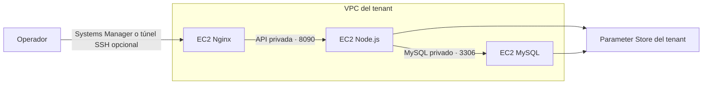

# OpenTofu para un tenant en AWS

El módulo toma el plan del [catálogo compartido con el panel](../../plataforma/planes.json) y crea una VPC y tres EC2 en Ohio. Cloud-init instala Nginx, Node.js y MySQL por separado. El código de asistencia se descarga desde un commit fijo del repositorio de origen. El perfil de backend lee sus dos parámetros de arranque y el de MySQL solo lee la contraseña de base de datos. El perfil de frontend en modo Systems Manager se limita a los canales del agente.



Las tres EC2 reciben IPv4 automáticas para descargar paquetes sin NAT Gateway. El modo predeterminado usa AWS Systems Manager y permite solo las conexiones entre capas en los grupos de seguridad. Para habilitar SSH de forma opcional, limita la entrada a una IPv4 autorizada. Los discos son gp3 cifrados. El estado conserva referencias de Parameter Store y las contraseñas se generan con un recurso efímero y un atributo de escritura exclusiva. [Atributos de escritura exclusiva de OpenTofu](https://opentofu.org/docs/v1.11/language/ephemerality/write-only-attributes/).

## Validar y preparar un plan

Se requiere OpenTofu 1.11 o superior. Desde esta carpeta:

```powershell
tofu init -backend=false
tofu fmt -check
tofu validate
```

Para un plan nuevo, define estos valores en un archivo local como `demo.tfvars` y selecciona el perfil del despliegue con `AWS_PROFILE`.

| Variable | Valor |
| --- | --- |
| `account_id` | Cuenta AWS autorizada para el proyecto, con 12 dígitos. |
| `tenant_id` | Identificador único del registro, como `instituto-demo`. |
| `environment` | `pruebas` o `produccion`. |
| `plan` | `basico`, `estandar` o `avanzado`. |
| `ami_id` | AMI x86_64 de Amazon Linux 2023 en Ohio. Resuélvela una vez y conserva el ID con la configuración de ese despliegue. |
| `operator_cidr` | Opcional para SSH. IPv4 pública del operador en formato `/32`. |
| `ssh_public_key` | Opcional para SSH. Contenido de la clave pública OpenSSH. Define esta variable junto con `operator_cidr`. |

```powershell
aws ssm get-parameter --region us-east-2 --name /aws/service/ami-amazon-linux-latest/al2023-ami-kernel-default-x86_64 --query Parameter.Value --output text
tofu plan -var-file=demo.tfvars -out=demo.tfplan
```

## Estado remoto y verificación de un despliegue

Antes de aplicar, usa un bucket S3 privado y versionado del proyecto. Copia `backend.tf.example` a `backend.tf`, inicializa el backend con una clave diferente por tenant y vuelve a generar el plan. Usa un directorio de datos de OpenTofu separado por tenant si alternas entre ellos en la misma copia de trabajo. Revisa el plan antes de aplicarlo. [Backend S3 de OpenTofu](https://opentofu.org/docs/language/settings/backends/s3/) · [Permisos de preparación](../../documentacion/aws-preparacion-demo.md).

```powershell
tofu init -reconfigure -backend-config="bucket=BUCKET_DEL_PROYECTO" -backend-config="key=tenants/INSTITUTO/terraform.tfstate"
tofu plan -var-file=demo.tfvars -out=demo.tfplan
tofu apply demo.tfplan
$instancias = tofu output -json instances | ConvertFrom-Json
aws ssm start-session --region us-east-2 --target $instancias.frontend.id --document-name AWS-StartPortForwardingSession --parameters 'portNumber=80,localPortNumber=8080'
```

La conexión local por Systems Manager requiere el complemento Session Manager de AWS CLI. Abre [el tenant por el túnel local](http://127.0.0.1:8080). La portada debe devolver HTTP 200 y `/api/me` debe devolver HTTP 401 sin sesión. Comprueba `sudo cloud-init status --wait` en las tres EC2 si algún servicio todavía no responde. El operador autorizado puede consultar la contraseña inicial del administrador en `/asistencia/proyecto-final-modulo-2/<tenant>/admin` desde Parameter Store. [Reenvío de puertos con Session Manager](https://docs.aws.amazon.com/systems-manager/latest/userguide/session-manager-working-with-sessions-start.html#sessions-start-port-forwarding).

Para suspender una prueba, detener sus tres EC2 conserva los discos. Al reanudar, consulta la nueva IPv4 del frontend para restablecer el túnel. Para retirar un tenant de prueba, revisa el plan de destrucción con su clave de estado y su archivo de variables. La destrucción elimina sus tres discos raíz, incluidos los datos de MySQL.
